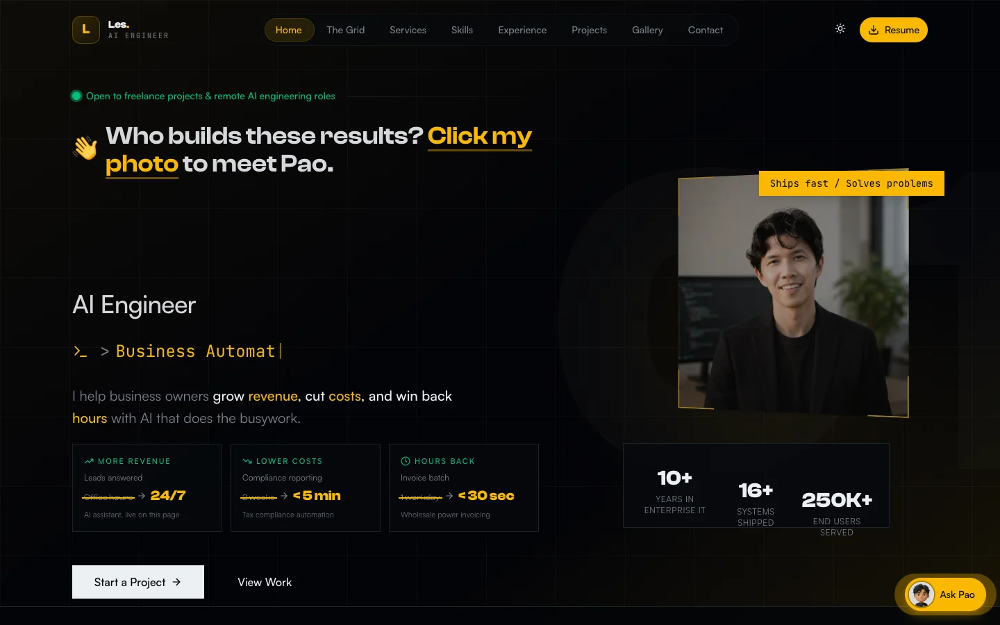
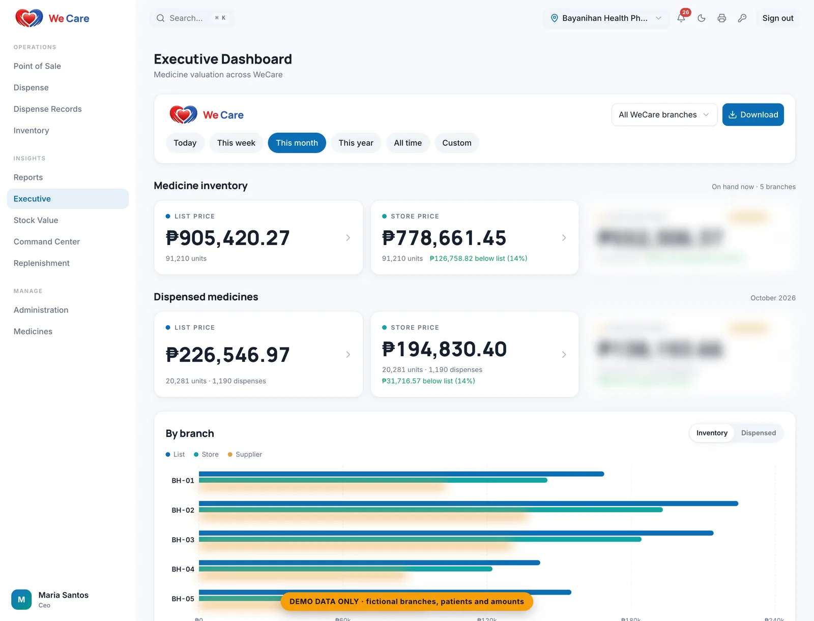
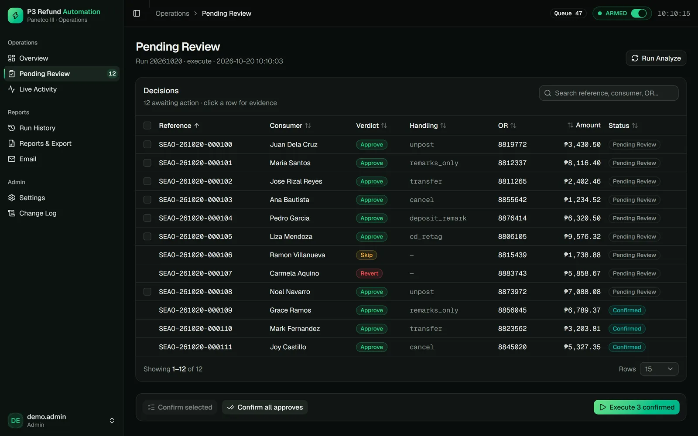
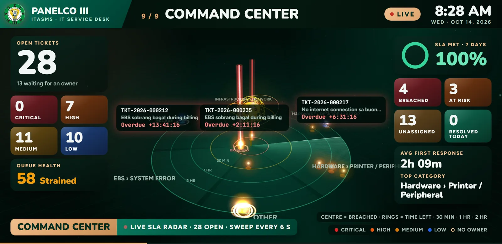
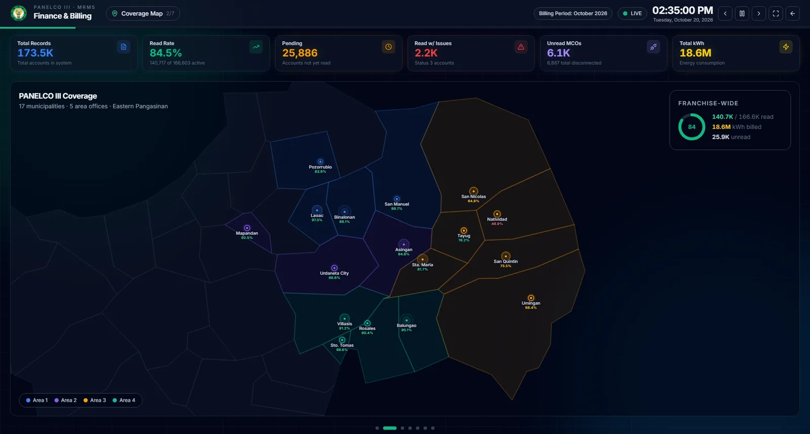
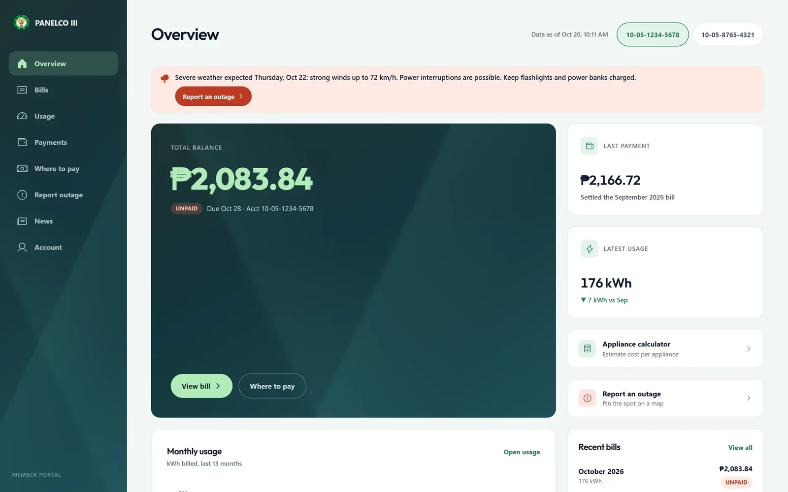
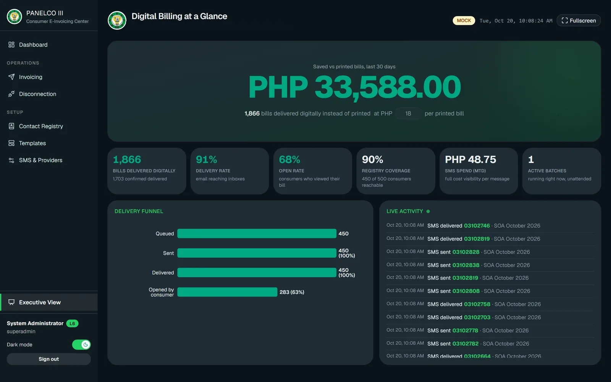
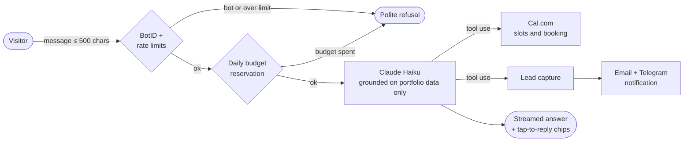

<div align="center">


[](https://lesjohnpauloliver.dev)

<a href="https://lesjohnpauloliver.dev"></a>
<a href="https://lesjohnpauloliver.dev/#contact"></a>
<a href="https://lesjohnpauloliver.dev/les-john-paul-oliver-resume.pdf"></a>
<br/>
<a href="https://www.linkedin.com/in/lesjohnpaul/"></a>
<a href="mailto:lesjohnpauloliver@gmail.com"></a>


<br/><br/>

<a href="https://lesjohnpauloliver.dev"></a>

<sub>↑ Live site. Click my photo there and <b>Pao</b>, my 3D AI assistant, pops out. Ask it anything about my work, or book a call with it.</sub>

</div>

<br/>

## ⚡ What I do

I'm an **AI engineer and freelancer** in the Philippines with 10 years of shipping production systems for an electric utility that serves **250,000+ member-consumers**. I don't build LLMs. I take Claude and other models and **wire them into the work a business already does**: answering customers, chasing leads, closing the books, and writing the reports nobody wants to write.

<table>
<tr>
<td width="33%" valign="top">

**📈 More revenue**<br/>
<sub>Leads answered</sub><br/>
~~office hours~~ → **24/7**<br/>
<sub>AI assistant that qualifies leads and books meetings itself</sub>

</td>
<td width="33%" valign="top">

**💸 Lower costs**<br/>
<sub>Tax compliance reporting</sub><br/>
~~2 weeks~~ → **under 5 min**<br/>
<sub>Two clicks generate the regulated PDFs straight from SQL Server</sub>

</td>
<td width="33%" valign="top">

**⏱️ Hours back**<br/>
<sub>Wholesale power invoicing</sub><br/>
~~1 workday~~ → **under 30 sec**<br/>
<sub>~50 invoices per batch, zero transcription errors, 59 tests</sub>

</td>
</tr>
</table>

<br/>

## 🧩 Featured work

<sub>Every card opens a full case study: the problem, the architecture, and what changed. Screens use demo data, and sensitive details are blurred.</sub>

<table>
<tr>
<td width="50%" valign="top">
<a href="https://lesjohnpauloliver.dev/work/wecare-pharmacy-pos-dispensing-platform"></a>
<b>WeCare · Pharmacy POS & Dispensing</b> <br/>
<sub>Multi-tenant, multi-branch pharmacy and clinic platform: PhilHealth claims, FEFO inventory, replenishment, CEO dashboards. Tenant isolation lives in Postgres row-level security.</sub><br/>
<sub><code>React 19</code> <code>Supabase</code> <code>PostgreSQL RLS</code></sub>
</td>
<td width="50%" valign="top">
<a href="https://lesjohnpauloliver.dev/work/ai-assisted-refund-automation"></a>
<b>AI-Assisted Refund Automation</b> <br/>
<sub>Claude reviews each flagged refund read-only and explains the fix. Rules and a human approve every action, and every change can be reversed.</sub><br/>
<sub><code>Claude API</code> <code>FastAPI</code> <code>SQL Server</code></sub>
</td>
</tr>
<tr>
<td width="50%" valign="top">
<a href="https://lesjohnpauloliver.dev/work/enterprise-it-service-management-platform"></a>
<b>Enterprise IT Service Management</b> <br/>
<sub>300 staff, 12 offices: SLA engine, approvals, QR asset custody, and a 9-screen TV command center. Load-tested at 300 simultaneous requests; 15K-ticket reports in under 500 ms (p95).</sub><br/>
<sub><code>React</code> <code>Node.js</code> <code>SQL Server</code></sub>
</td>
<td width="50%" valign="top">
<a href="https://lesjohnpauloliver.dev/work/meter-reading-platform-legacy-modernization"></a>
<b>Meter Reading · Legacy Modernization</b><br/>
<sub>Legacy PHP/jQuery rebuilt in React and Fastify, running side by side on the live database with no migration downtime. Adds anomaly detection and invoice-gap analysis.</sub><br/>
<sub><code>React</code> <code>Fastify</code> <code>MySQL</code></sub>
</td>
</tr>
<tr>
<td width="50%" valign="top">
<a href="https://lesjohnpauloliver.dev/work/consumer-billing-self-service-portal"></a>
<b>Consumer Billing & Self-Service Portal</b><br/>
<sub>Bills, usage, outages, and where to pay, for 250,000+ consumers. An on-prem sync agent feeds the cloud portal.</sub><br/>
<sub><code>Next.js</code> <code>Supabase</code> <code>Cloudflare Tunnel</code></sub>
</td>
<td width="50%" valign="top">
<a href="https://lesjohnpauloliver.dev/work/consumer-e-invoicing-notification-platform"></a>
<b>Consumer E-Invoicing & Notifications</b> <br/>
<sub>Password-protected PDF statements by email and SMS, with automatic provider fallback. 183K+ recipients.</sub><br/>
<sub><code>Node.js</code> <code>Amazon SES</code> <code>SQL Server</code></sub>
</td>
</tr>
</table>

<div align="center"><a href="https://lesjohnpauloliver.dev/#projects"><b>See all 23 projects →</b></a></div>

<br/>

## 🤖 Meet Pao: the AI assistant on my site

Pao answers questions about my work, checks my live calendar, and books calls. It runs on my own Claude API credits, so I built it to be **hard to abuse and cheap to run** (about **$0.0002 per message** with prompt caching).



<sub><b>Guardrails:</b> answers only from verified portfolio facts · ignores pasted code and prompt injection · history kept server-side in Redis · 40 messages/hour and 100/day per IP · 20 turns per conversation · atomic daily spend cap.</sub>

<br/>

## 🛠️ Stack I ship with

<div align="center">

<br/>


</div>

<br/>

## 📊 By the numbers

<div align="center">
<table>
<tr>
<td align="center"><h3>250K+</h3><sub>consumers served by<br/>systems I built</sub></td>
<td align="center"><h3>16+</h3><sub>production systems<br/>shipped as architect</sub></td>
<td align="center"><h3>13,000+</h3><sub>attendees checked in<br/>across 5 venues</sub></td>
<td align="center"><h3>₱14.95M</h3><sub>Azure hybrid migration,<br/>sole architect</sub></td>
</tr>
<tr>
<td align="center"><h3>1.17 TB</h3><sub>SQL Server data<br/>run as DBA</sub></td>
<td align="center"><h3>183K+</h3><sub>e-invoice<br/>recipients</sub></td>
<td align="center"><h3>300</h3><sub>staff on the ITSM<br/>platform, 12 offices</sub></td>
<td align="center"><h3>10 yrs</h3><sub>in production,<br/>promoted 3×</sub></td>
</tr>
</table>
</div>

<br/>

## 🏗️ About this repo

This repo is my GitHub profile **and** the source of [lesjohnpauloliver.dev](https://lesjohnpauloliver.dev).

| Piece | How it's built |
|---|---|
| App | Next.js 16 (App Router, Turbopack), React 19, Tailwind 4 |
| Motion | GSAP scroll reveals and CSS-only "AI ops" scenes that play only while on screen and respect reduced motion |
| 3D Pao | Procedural Three.js model (8.7K triangles, ~11 KB gzip) on React Three Fiber, loaded only when you meet it |
| Case studies | 23 statically generated `/work/[slug]` pages with CreativeWork JSON-LD and a sitemap |
| Chat | Anthropic SDK with prompt caching, Upstash Redis, Vercel BotID, Cal.com v2, Resend, Telegram |
| Hosting | Vercel (Fluid Compute) with Web Analytics and Speed Insights |

<details>
<summary><b>Run it locally</b></summary>

```bash
git clone https://github.com/lesjohnpaul/lesjohnpaul.git
cd lesjohnpaul
npm install
vercel env pull .env.local   # or create .env.local with the variables below
npm run dev                  # http://localhost:3000
```

| Variable | Used for |
|---|---|
| `ANTHROPIC_API_KEY` | Pao chat (Claude) |
| `CHAT_DAILY_BUDGET_USD` | Daily spend cap for the chat |
| `KV_REST_API_URL`, `KV_REST_API_TOKEN` | Upstash Redis: rate limits, history, budget |
| `CAL_API_KEY`, `CAL_EVENT_TYPE_ID` | Live slots and booking |
| `RESEND_API_KEY`, `RESEND_FROM` | Contact form and lead emails |
| `TELEGRAM_BOT_TOKEN`, `TELEGRAM_CHAT_ID` | Instant lead alerts |

The site builds and renders without these. Only chat, booking, and email need them.

</details>

<br/>

<div align="center">

<a href="https://github.com/lesjohnpaul"></a>
<a href="https://github.com/lesjohnpaul"></a>

<a href="https://github.com/lesjohnpaul"></a>

<br/><br/>

**Have a process that eats your team's week?** [Tell Pao about it](https://lesjohnpauloliver.dev) or [email me](mailto:lesjohnpauloliver@gmail.com).


</div>
